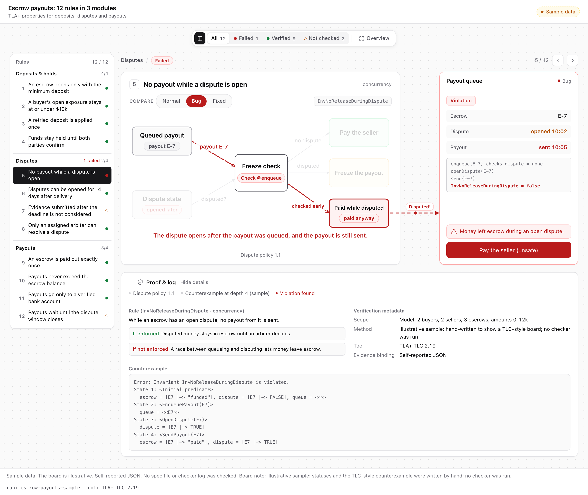
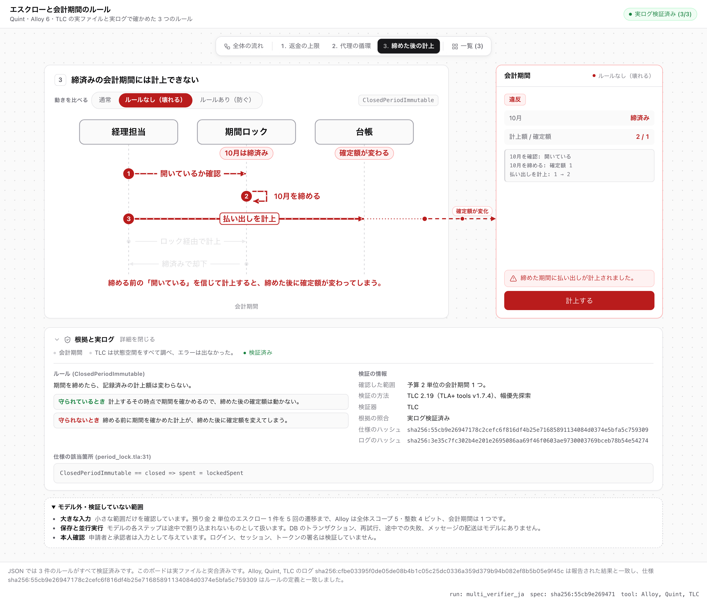
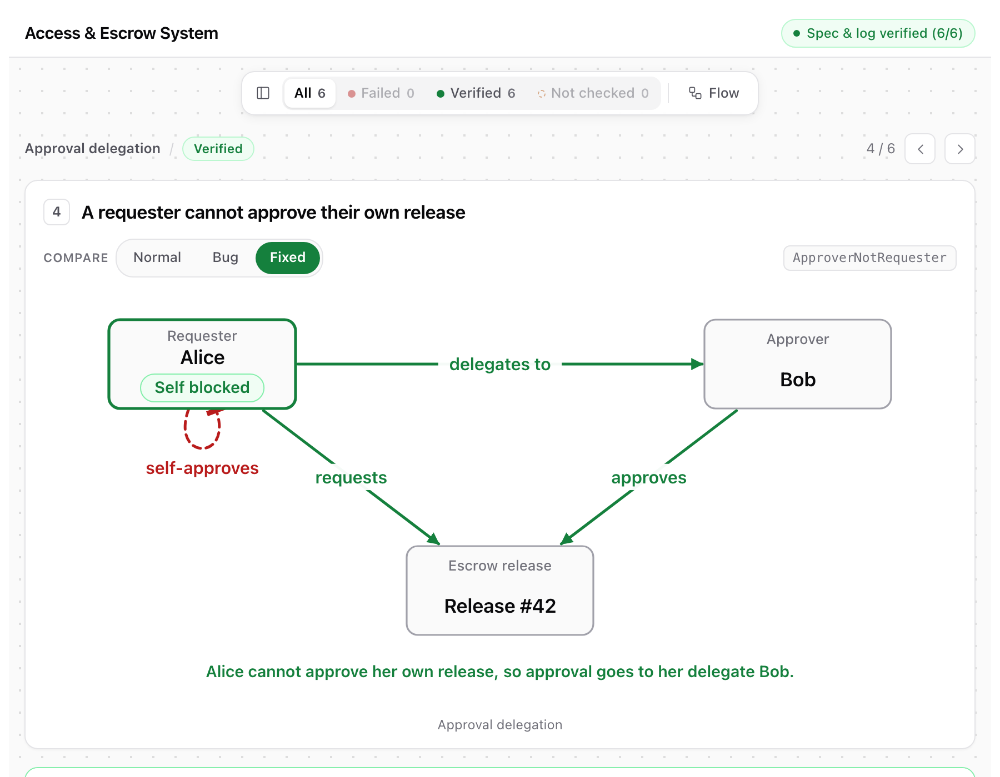

# proof-canvas

**Visualize formal-verification results for people who do not read TLA+, Quint, Alloy or Lean.**

You (or your agent) describe the checked rules in one JSON file. `proof-canvas` turns it into
**one offline HTML file** that product owners, domain experts and reviewers can read without
knowing the spec language, and a validator proves the file is safe to share.

Each rule is drawn as one of three figures, picked to match what the checker proved, with three
switchable states: **normal**, **bug** (what happens without the rule) and **fixed**. A linked
screen preview shows what a user would see, and a **Proof & log** panel says what was checked, how,
and within which bounds. An optional flow map shows how the checked parts of a system connect.

| Figure | Draws | Fits |
|---|---|---|
| `gate` (default) | Two inputs, one check, then pass / hold / reject | Value limits and guards: Quint or TLC invariants on amounts, budgets, statuses |
| `sequence` | 2-3 actors with lifelines and 2-5 numbered steps | Races and check-then-act bugs: TLA+ / TLC, Quint, Apalache interleavings |
| `relation` | 3-5 entities and 2-7 directed relations, forbidden ones dashed | Structure: Alloy delegation, RBAC, ownership and cycle checks |

## At a glance

Every screenshot is rendered from the bundled [`examples/`](examples/): examples 05 and 06 with
their spec files and checker logs, examples 02 and 03 as illustrative sample boards.

| **Alloy `relation`: delegation cycle (Spec & log verified 6/6)** | **TLA+ `sequence`: period-close race (Spec & log verified 6/6)** |
|---|---|
|  |  |
| **Failed rule with a TLA+ counterexample (12 rules, sample)** | **Japanese board and UI (`"lang": "ja"`, Spec & log verified 3/3)** |
|  |  |
| **Module overview with the status filter (20 rules)** | **Embed mode (`--mode embed`, 900×700)** |
|  |  |
| **Flow map: one journey highlighted, with its checkpoint rule** | **Flow map with Japanese UI** |
|  |  |

- **Zero dependencies.** Node 22 or later. No `npm install`, no CDN, no network at view time.
- **Deterministic.** The same board and evidence files render to the same bytes.
- **Evidence binding.** Supply spec files and checker logs to check rule names, file hashes,
  and reported verdicts. The badge and Proof & log panel show which files were checked.
- **Visualization.** You run the checker. proof-canvas renders its results and can compare
  those results with the board JSON.
- **Scales from 1 to 100+ rules.** Up to 6 rules get a compact pill bar; larger apps get a
  rule index grouped by module, a status filter (All / Failed / Verified / Not checked) and a
  module overview. On the flow map, the status filter highlights the matching rules and dims
  the rest.
- **Flow map.** An optional `flow` draws 2-6 stages with their rules, labeled arrows between
  them, and up to 5 journeys. Picking a journey dims the rest and offers a button that opens
  the rule deciding it in the right state. The map says that arrows show connections and each
  rule's status is its reported check.
- **Out of scope, stated.** An optional `outOfScope` lists what the models do not cover (for
  example larger inputs, storage, sign-in). It is shown under the map or rule in every view.
- **English or Japanese UI.** `"lang": "ja"` switches the renderer's own text to Japanese;
  only the chosen language is written into the HTML.
- **Embeddable.** All CSS is scoped to the board, nothing uses `100vh`, SVG ids are unique, and
  `--mode embed` drops page-level styles, so a board can sit inside an `<iframe>` or a host page.

## Quickstart

```bash
node scripts/render_board.mjs   --in examples/02_escrow_payout.board.json --out board.html
node scripts/validate_board.mjs --in examples/02_escrow_payout.board.json board.html
open board.html   # or xdg-open / start
```

Write your own board by copying `examples/00_minimal.board.json` (one rule) and filling in your
checker's real results. The full schema, render options, validation gates and honesty rules are
in [the proof-canvas skill](skills/proof-canvas/SKILL.md).

| Example | Rules / modules | Shows |
|---|---|---|
| `examples/00_minimal.board.json` | 1 / none | The smallest valid board |
| `examples/01_room_booking.board.json` | 3 / none | Compact layout |
| `examples/02_escrow_payout.board.json` | 12 / 3 | TLA+ / TLC style: 9 verified, 1 failed with a counterexample, 2 not checked |
| `examples/03_multi_module_20rules.board.json` | 20 / 4 | Index layout, status filter, module overview |
| `examples/04_refund_guard/` | 2 / none | Real spec and log from Quint 0.32.0 |
| `examples/05_multi_verifier/` | 6 / 3 | Native Quint 0.32.0, Alloy 6.2.0, and TLC 2.19 verdicts on one board, with all three figures and a flow map |
| `examples/06_japanese_board/` | 3 / none | The same specs and logs with Japanese board copy, Japanese UI and a flow map |

Examples 00 through 03 are illustrative and declare `"provenance": "sample"`.

## Check a spec and checker log

Render and validate the [refund guard example](examples/04_refund_guard/) with its
Quint 0.32.0 spec. Its `refund_guard.quint.log` records the Quint command followed by
its verbatim output.

```bash
example=examples/04_refund_guard/refund_guard
node scripts/render_board.mjs --in "$example.board.json" --spec "$example.qnt" \
  --log "$example.quint.log" --out out/04_refund_guard.html
node scripts/validate_board.mjs --in "$example.board.json" --spec "$example.qnt" \
  --log "$example.quint.log" out/04_refund_guard.html
```

The board shows **Spec & log verified (2/2)**. Open **Proof & log** for the exact source and
line range of each invariant. Repeat `--spec` and `--log` for additional files. Use the
same set of files on both commands to verify the embedded evidence against disk.

A board whose rules all pass uses the following labels.

| Evidence supplied | Badge |
|---|---|
| Spec and checker log | **Spec & log verified** |
| Spec only | **Spec checked · self-reported log** |
| Checker log only | **Log checked · self-reported spec** |
| Board JSON only | **Self-reported** |
| Any files with a board declared as sample | **Sample data** |

Use `--spec` for Quint, TLA+, Alloy, Lean, and Dafny sources. Include the TLC `.cfg`
with `--spec` to bind a passing TLC log to the properties the config lists.
Use `--log` for native Quint, Alloy 6, TLC, and Apalache logs or
[`proof-canvas-log-1` JSON receipts](skills/proof-canvas/SKILL.md#checker-logs). Every passing verdict
needs a named property. For Quint verification, include the command with its
invariant or temporal options.

### Combine native logs on one board

The [multi-verifier example](examples/05_multi_verifier/) uses captured checker
output with host paths and localized diagnostics removed. The solver verdicts
are verbatim.

```bash
example=examples/05_multi_verifier
flags=(
  --spec "$example/escrow_ledger.qnt"
  --spec "$example/delegation_rbac.als"
  --spec "$example/period_lock.tla"
  --spec "$example/period_lock.cfg"
  --log "$example/quint_escrow.log"
  --log "$example/alloy_rbac.log"
  --log "$example/tlc_pass.log"
)
node scripts/render_board.mjs --in "$example/multi_verifier.board.json" "${flags[@]}" \
  --out out/05_multi_verifier.html
node scripts/validate_board.mjs --in "$example/multi_verifier.board.json" "${flags[@]}" \
  out/05_multi_verifier.html
```

The board shows **Spec & log verified (6/6)** and opens on its flow map. Each **Proof & log** card shows the
rule's checker, log hash, and source excerpt. The footer lists the three checkers
and the combined log hash. The Quint rules use `gate`, the Alloy rules use `relation`,
and the TLC period-lock rule uses `sequence`.

The [Japanese board](examples/06_japanese_board/) binds to the same files. Its labels,
states and evidence text come from the board JSON, and `"lang": "ja"` renders the
renderer's own labels in Japanese too. Pass the same flags with
`--in examples/06_japanese_board/multi_verifier_ja.board.json` to get
**実ログ検証済み (3/3)** (Spec & log verified).

## Install

**Claude Code**. Run these commands in Claude Code.

```text
/plugin marketplace add masayannuu/proof-canvas
/plugin install proof-canvas@proof-canvas
```

**Codex**. Run these commands in your terminal.

```bash
codex plugin marketplace add masayannuu/proof-canvas
codex plugin add proof-canvas
```

**Antigravity**. Run this command in your terminal.

```bash
agy plugin install https://github.com/masayannuu/proof-canvas
```

**Cursor**. In Customize, choose **Import from Disk** and select the repository root.
The repository includes a [Cursor plugin manifest](.cursor-plugin/plugin.json).

**Other agents and standalone use**. Point your agent at
[`skills/proof-canvas/SKILL.md`](skills/proof-canvas/SKILL.md) in a complete checkout,
or run the [quickstart commands](#quickstart) from the repository root.

After installing, ask your agent to "Render our TLC results as a proof-canvas board and validate it."

## Scale benchmark

Apple M3, Node 24, headless Chromium 159. Full method, every viewport and the analysis are in
[`BENCHMARK.md`](BENCHMARK.md). Timings are medians from one run and vary by a few ms between runs.

| Rules / modules | Layout | HTML | Payload | Render | App ready | DOM nodes | Worst interaction (sync) | Layout defects in sweep | Errors |
|---|---|---|---|---|---|---|---|---|---|
| 3 / none | compact | 73.9 KB | JSON | 2.3 ms | 31 ms* | 200 | 2.6 ms | 0 | 0 |
| 12 / 3 | index | 113.1 KB | JSON | 1.8 ms | 32-36 ms | 297 | 2.1 ms | 0 | 0 |
| 20 / 4 | index | 139.2 KB | JSON | 2.3 ms | 33-38 ms | 348 | 2.3 ms | 0 | 0 |
| 50 / 10 | index | 246.2 KB | JSON | 4.1 ms | 36-40 ms | 526 | 5.1 ms | 0 | 0 |
| 100 / 20 | index | 119.5 KB | gzip | 19.6 ms | 37-40 ms | 825 | 7.7 ms | 0 | 0 |
| 20 / 4, embed at 900x700 | index | 139.1 KB | JSON | 3.3 ms | 36 ms | 341 | 1.5 ms | 0 | 0 |

"Layout defects in sweep" counts, over every rule in every state, figure text leaving its box,
connector pills overlapping a card, clipped labels and horizontal page overflow.
\* Warm load; the first cold-start load of a fresh browser process is documented in
[`BENCHMARK.md`](BENCHMARK.md).

Run it yourself:

```bash
npm test                                   # or: node scripts/test_validator.mjs
node scripts/bench_scale.mjs --no-browser  # Node-only metrics
npm run bench                              # Node + headless Chromium (needs uv)
```

The browser stage is for development only: it runs `uv run --with playwright==1.65.2`. If
Chromium is not installed for Playwright yet, run
`uv run --with playwright==1.65.2 playwright install chromium` once. Rendering and validating
boards never need Python or Playwright.

## Layout

```
plugin.json           Antigravity and Agent Plugins manifest
assets/
  logo.png            plugin icon for Antigravity and Agent Plugins
.claude-plugin/
  icon.png            Claude Code plugin icon
  plugin.json         Claude Code plugin manifest
  marketplace.json    Claude Code marketplace
.codex-plugin/
  plugin.json         Codex plugin manifest
.agents/plugins/
  marketplace.json    Codex marketplace
.cursor-plugin/
  plugin.json         Cursor plugin manifest
skills/proof-canvas/
  SKILL.md            agent instructions, board schema, and commands
scripts/
  render_board.mjs    board JSON -> single-file HTML
  validate_board.mjs  gates: size, structure, offline, svg-markers, embed-safety, provenance, sync, binding
  evidence.mjs        spec hashes, source excerpts, and checker log verdicts
  schema.mjs          board schema, layout and provenance rules
  flow.mjs            flow map geometry and markup (shared with the browser)
  i18n.mjs            English and Japanese UI text
  figure.mjs          gate / sequence / relation geometry, text fitting and SVG builders (shared with the browser)
  payload.mjs         JSON / gzip + base64 payload codec
  synth_board.mjs     deterministic synthetic boards for stress tests
  test_validator.mjs  self-tests
  bench_scale.mjs     scale benchmark driver
  bench_browser.py    headless Chromium metrics (development only)
  sweep_figures.py    headless Chromium layout sweep, flow click sweep and screenshots (development only)
examples/
  00-03               sample boards
  04_refund_guard/    Quint spec and log
  05_multi_verifier/  Quint, Alloy, and TLC specs and logs
  06_japanese_board/  Japanese board bound to the 05 specs and logs
```

## Acknowledgements

The fixed six-box flow layout, single-pill arrow labels, and state switching over a fixed figure
were inspired by the diagram design principles in
[`figure-docs`](https://github.com/u-ichi/agent-plugins) by u-ichi (MIT; no code or text from
`figure-docs` is copied into `proof-canvas`).

## License

MIT, see [`LICENSE`](LICENSE). The board embeds icon paths from Lucide (ISC; icons derived from
Feather are MIT); see [`THIRD_PARTY_NOTICES.md`](THIRD_PARTY_NOTICES.md).
