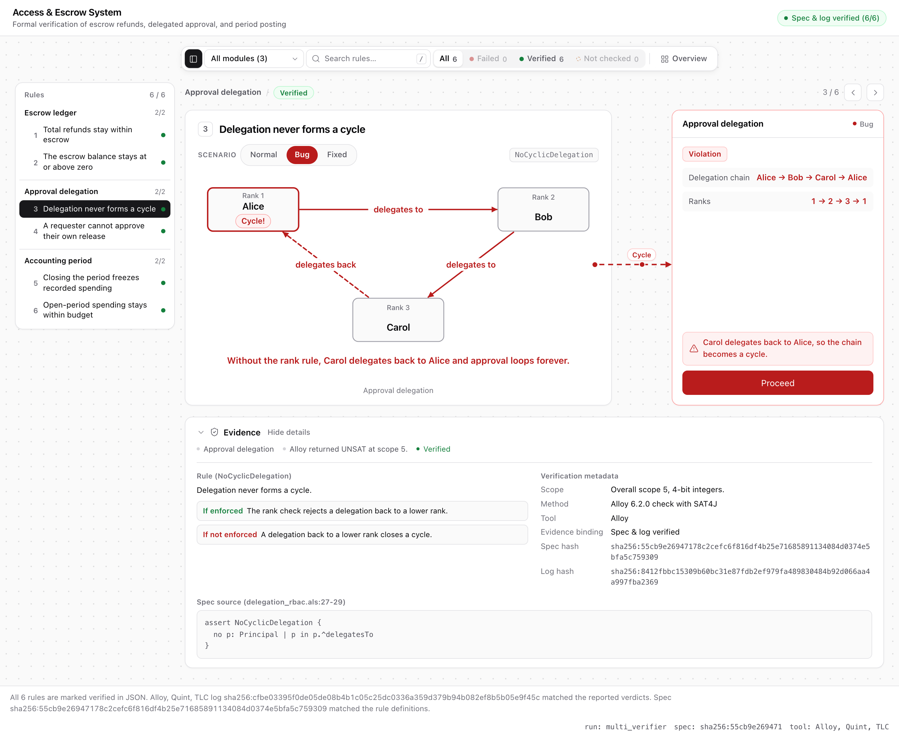
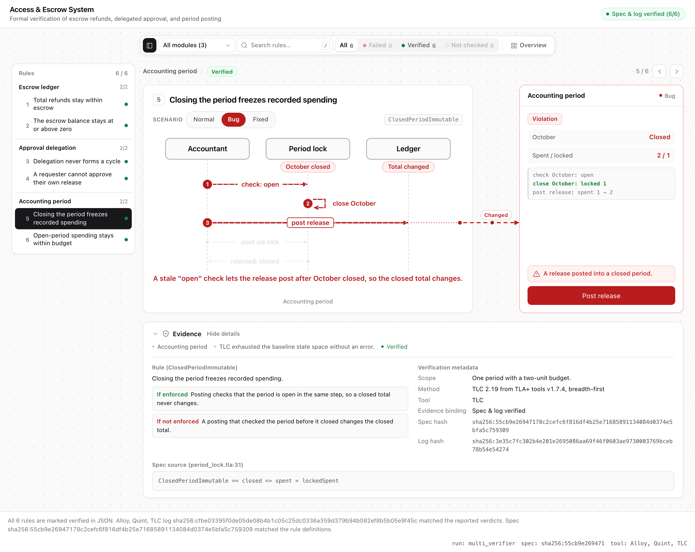
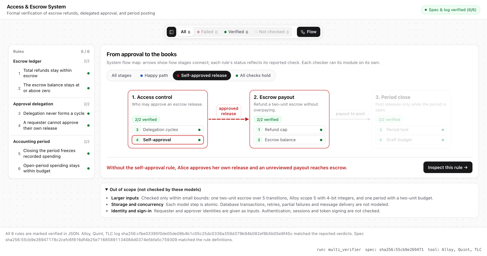
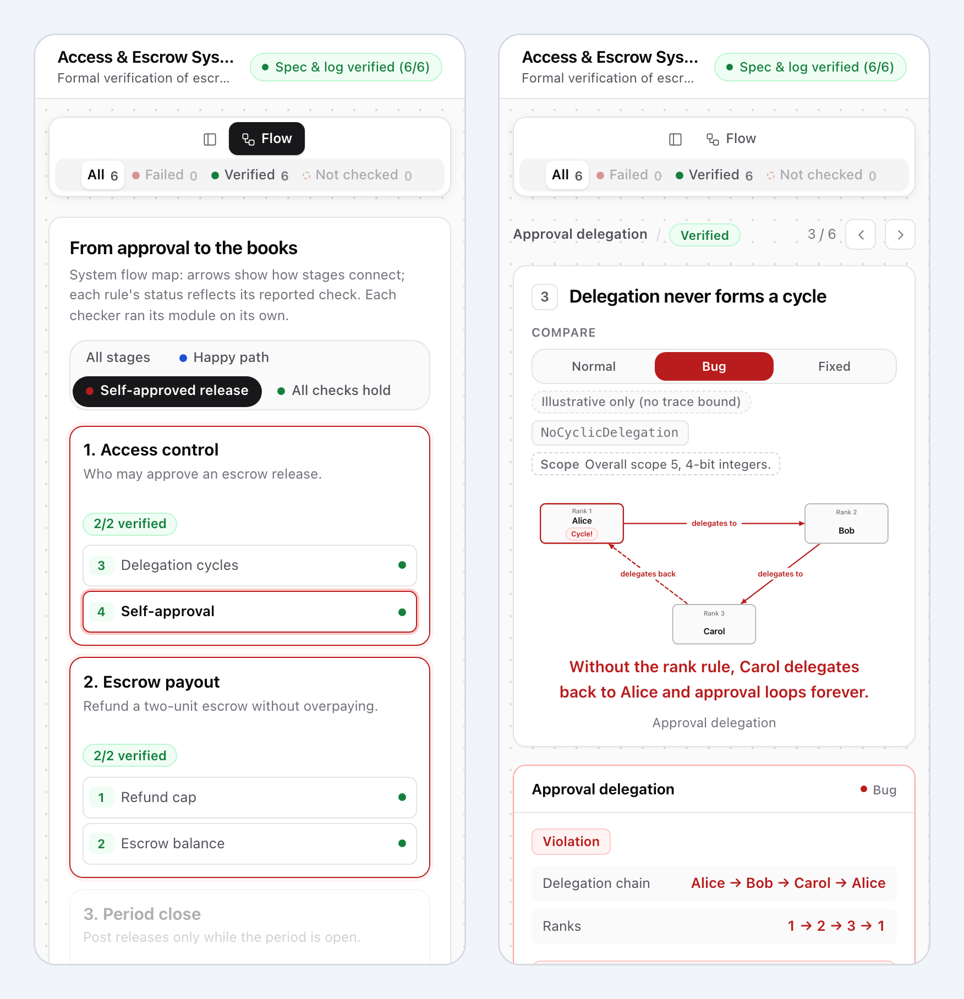
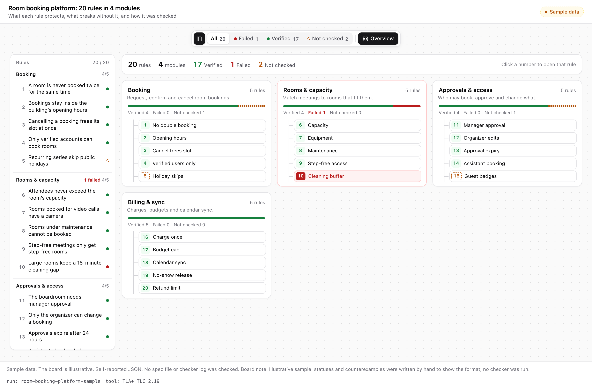
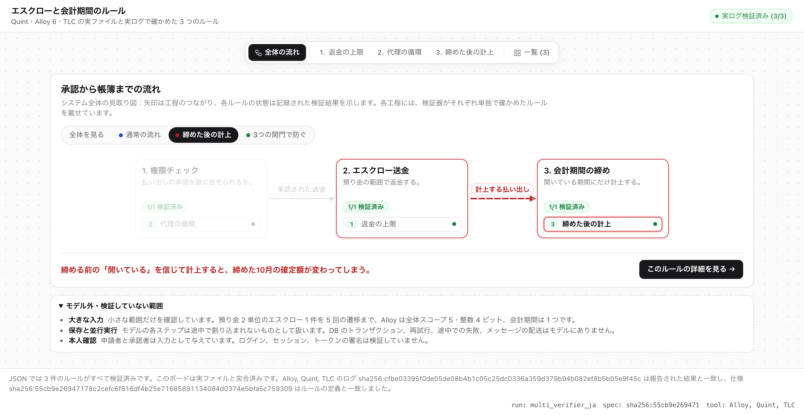
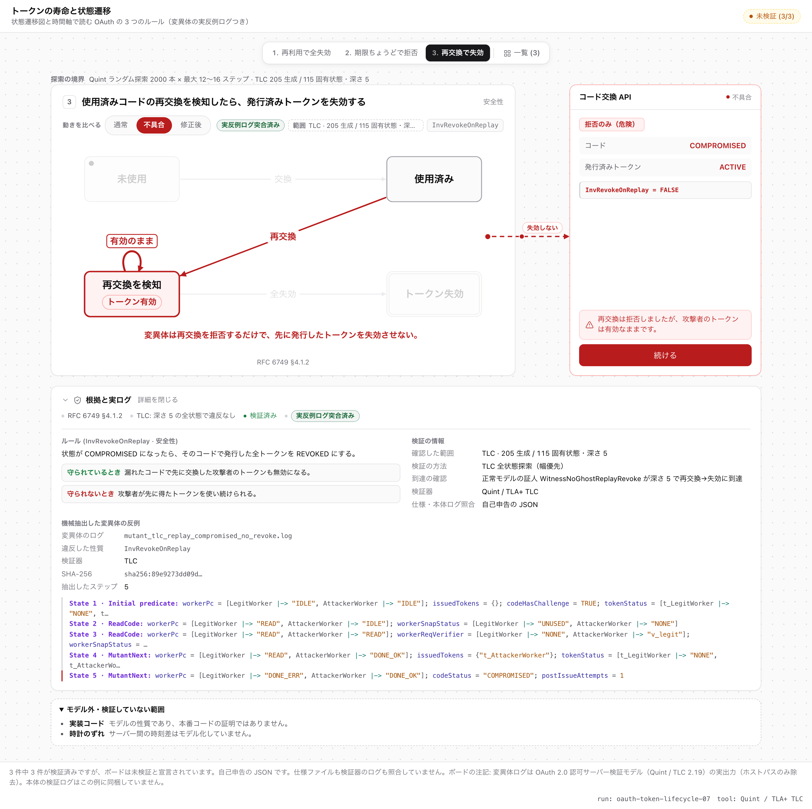
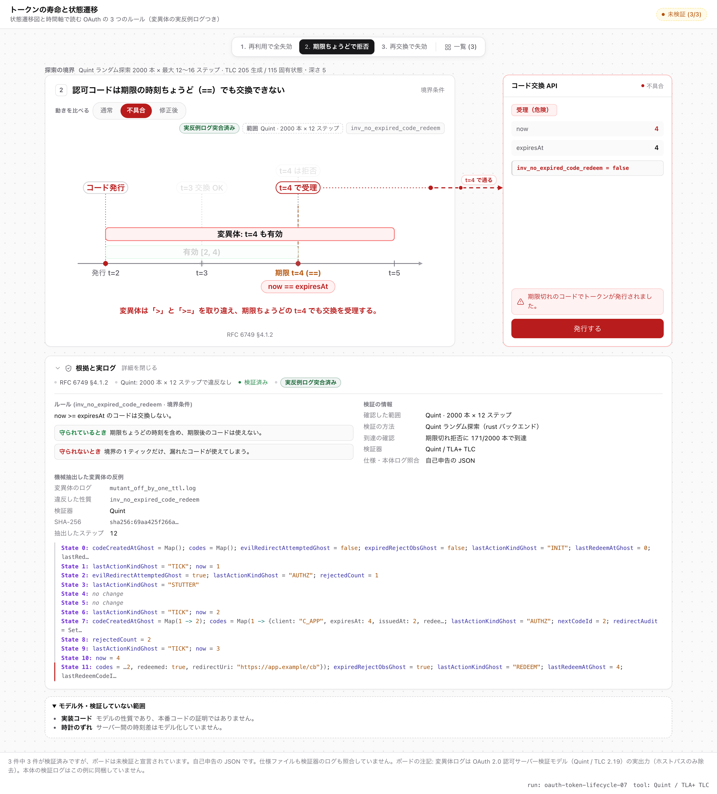

# proof-canvas

**Visualize formal-verification results for people who do not read TLA+, Quint, Alloy or Lean.**

You (or your agent) describe the checked rules in one JSON file. `proof-canvas` turns it into
**one offline HTML file** that product owners, domain experts and reviewers can read without
knowing the spec language, and a validator proves the file is safe to share.

Each rule is drawn as one of five figures with three switchable states (**normal**, **bug** and
**fixed**), paired with a linked screen preview and a **Proof & log** panel showing what was
checked, how, and within which bounds. An optional flow map shows how the checked parts connect.

| Figure | Draws | Fits |
|---|---|---|
| `gate` (default) | Two inputs, one check, then pass / hold / reject | Value limits and guards: Quint or TLC invariants on amounts, budgets, statuses |
| `sequence` | 2-3 actors with lifelines and 2-5 numbered steps | Races and check-then-act bugs: TLA+ / TLC, Quint, Apalache interleavings |
| `relation` | 3-5 entities and 2-7 directed relations, forbidden ones dashed | Structure: Alloy delegation, RBAC, ownership and cycle checks |
| `state` | 2-5 states and 1-8 transitions: start dot, terminal border, forbidden and loop transitions | Lifecycles and revocation: token families, order or account status machines |
| `timeline` | 2-5 time points, 1-3 windows and 1-4 events, with boundary lines | Expiry and deadlines: TTL, off-by-one boundaries, grace periods |

## At a glance

Rendered from the bundled [`examples/`](examples/) (real Quint, Alloy and TLC specs/logs in 05–07; sample boards in 02–03).

| **Alloy `relation`: delegation cycle (`Spec & log verified`, highlighted `.als`)** | **TLA+ `sequence`: period-close race (`Spec & log verified`, highlighted `.tla`)** |
|---|---|
|  |  |
| **Flow map: journey highlighted with checkpoint CTA** | **Mobile phones (`390×844`): stacked Flow map & full-fit rule figure** |
|  |  |

<details>
<summary>More screenshots (overview, failed counterexample, embed, Japanese UI &amp; mutant traces)</summary>

| **Module overview with status filter (20 rules)** | **Failed `gate` rule with a TLA+ counterexample (12 rules, sample)** |
|---|---|
|  |  |
| **Embed mode (`--mode embed`, 900×700)** | **Flow map with Japanese UI (`"lang": "ja"`, `実ログ検証済み 3/3`)** |
|  |  |
| **`state` figure + TLC mutant trace (Japanese UI, `--mutant-log`)** | **`timeline` figure + Quint mutant trace (Japanese UI, `--mutant-log`)** |
|  |  |

</details>

## Install

**Claude Code**. Run these commands in Claude Code.

```text
/plugin marketplace add masayannuu/proof-canvas
/plugin install proof-canvas@proof-canvas
```

**Codex**. Run these commands in your terminal.

```bash
codex plugin marketplace add masayannuu/proof-canvas
codex plugin add proof-canvas
```

**Antigravity**. Run this command in your terminal.

```bash
agy plugin install https://github.com/masayannuu/proof-canvas
```

**Cursor**. In Customize, choose **Import from Disk** and select the repository root.
The repository includes a [Cursor plugin manifest](.cursor-plugin/plugin.json).

**Other agents and standalone use**. Point your agent at
[`skills/proof-canvas/SKILL.md`](skills/proof-canvas/SKILL.md) in a complete checkout,
or run the [quickstart commands](#quickstart) from the repository root.

After installing, try one of these prompts with your agent:

- **Basic board (TLC / Quint / Alloy):**
  > "Use proof-canvas to render our TLC / Quint / Alloy verification results as a single offline HTML review board and validate it."
- **Full verified board with flow map, mutant kills & bounds:**
  > "Build a proof-canvas board bound to our specs and checker logs (`--spec`, `--log`), attach our killed-mutant logs (`--mutant-log`), include a system flow map with journeys and `outOfScope`, and run `validate_board.mjs`."
- **Japanese board or property-based testing (PropEr / fast-check / Hypothesis):**
  > "PropEr / fast-check の検証結果（または形式検証の結果）を proof-canvas で日本語 UI（`"lang": "ja"`）の仕様レビューボードにして検証して。"

## Highlights

- **Zero dependencies, offline, deterministic.** Node 22 or later; no `npm install`, no CDN, no network at view time, and byte-identical output for the same inputs.
- **Honest visualization.** You run the checker; `proof-canvas` renders its results and verifies bound spec files, checker logs, and killed-mutant traces against disk.
- **Bounds & scope in view.** `run.bounds` is shown above every view, `evidence.scope` sits as a chip next to each property, and optional `outOfScope` lists what the models omit.
- **Scales from 1 to 100+ rules.** Compact pill bar up to 6 single-module rules; module-grouped rule index, status filter (All / Failed / Verified / Not checked), and module overview beyond that.
- **System flow map.** Optional `flow` draws 2–6 stages, labeled arrows, and up to 5 journeys that dim unrelated stages and jump directly to the deciding rule.
- **English or Japanese UI.** `"lang": "ja"` switches renderer labels to Japanese and writes only the chosen language into the HTML.
- **Embeddable.** All CSS is scoped to `.pc-root`, nothing uses `100vh`, SVG ids are unique, and `--mode embed` drops page-level styles for `<iframe>` or host-page embedding.

## Quickstart

```bash
node scripts/render_board.mjs   --in examples/02_escrow_payout.board.json --out board.html
node scripts/validate_board.mjs --in examples/02_escrow_payout.board.json board.html
open board.html   # or xdg-open / start
```

Start your own board from `examples/00_minimal.board.json` and fill in your checker's real results.
The full schema, render options, validation gates and honesty rules are in
[the proof-canvas skill](skills/proof-canvas/SKILL.md).

| Example | Rules / modules | Shows |
|---|---|---|
| `examples/00_minimal.board.json` | 1 / none | The smallest valid board |
| `examples/01_room_booking.board.json` | 3 / none | Compact layout |
| `examples/02_escrow_payout.board.json` | 12 / 3 | TLA+ / TLC style: 9 verified, 1 failed with a counterexample, 2 not checked |
| `examples/03_multi_module_20rules.board.json` | 20 / 4 | Index layout, status filter, module overview |
| `examples/04_refund_guard/` | 2 / none | Real spec and log from Quint 0.32.0 |
| `examples/05_multi_verifier/` | 6 / 3 | Native Quint 0.32.0, Alloy 6.2.0, and TLC 2.19 verdicts on one board, with `gate`, `relation` and `sequence` figures and a flow map |
| `examples/06_japanese_board/` | 3 / none | The same specs and logs with Japanese board copy, Japanese UI and a flow map |
| `examples/07_state_timeline/` | 3 / none | `state` and `timeline` figures, `run.bounds`, and three real Quint and TLC mutant logs bound with `--mutant-log` |

Examples 00 through 03 are illustrative and declare `"provenance": "sample"`.

## Check a spec and checker log

Render and validate the [refund guard example](examples/04_refund_guard/) with its Quint 0.32.0 spec and log:

```bash
example=examples/04_refund_guard/refund_guard
node scripts/render_board.mjs --in "$example.board.json" --spec "$example.qnt" \
  --log "$example.quint.log" --out out/04_refund_guard.html
node scripts/validate_board.mjs --in "$example.board.json" --spec "$example.qnt" \
  --log "$example.quint.log" out/04_refund_guard.html
```

The board shows **Spec & log verified (2/2)** and opens each invariant's source excerpt and SHA-256 hashes under **Proof & log**. Pass the same `--spec` and `--log` flags to both commands to verify embedded evidence against disk.

A board whose rules all pass uses these provenance badges:

| Evidence supplied | Badge |
|---|---|
| Spec and checker log | **Spec & log verified** |
| Spec only | **Spec checked · self-reported log** |
| Checker log only | **Log checked · self-reported spec** |
| Board JSON only | **Self-reported** |
| Any files with a board declared as sample | **Sample data** |

Repeat `--spec` for Quint, TLA+ (with any TLC `.cfg`), Alloy, Lean and Dafny sources. Repeat `--log` for native Quint, Alloy 6, TLC and Apalache logs or [`proof-canvas-log-1` JSON receipts](skills/proof-canvas/references/evidence.md#checker-logs). Every passing verdict requires a named property (include the `quint verify` command for Quint logs).

### Combine native logs on one board

The [multi-verifier example](examples/05_multi_verifier/) combines Quint, Alloy 6 and TLC verdicts on one flow-mapped board (**Spec & log verified (6/6)**):

```bash
example=examples/05_multi_verifier
flags=(
  --spec "$example/escrow_ledger.qnt"
  --spec "$example/delegation_rbac.als"
  --spec "$example/period_lock.tla"
  --spec "$example/period_lock.cfg"
  --log "$example/quint_escrow.log"
  --log "$example/alloy_rbac.log"
  --log "$example/tlc_pass.log"
)
node scripts/render_board.mjs --in "$example/multi_verifier.board.json" "${flags[@]}" \
  --out out/05_multi_verifier.html
node scripts/validate_board.mjs --in "$example/multi_verifier.board.json" "${flags[@]}" \
  out/05_multi_verifier.html
```

Pass the same flags with `--in examples/06_japanese_board/multi_verifier_ja.board.json` for the [Japanese board](examples/06_japanese_board/) (`"lang": "ja"`, **実ログ検証済み (3/3)**).

### Bind killed mutants

A mutant run (with the rule switched off) shows the property can fail. Attach its log with `--mutant-log <ruleId>=<path>` on both commands to pair your bug diagram with the machine-extracted trace under **Proof & log**:

```bash
example=examples/07_state_timeline
flags=(
  --mutant-log refresh_reuse="$example/mutant_reuse_rotated_accepted.log"
  --mutant-log code_ttl="$example/mutant_off_by_one_ttl.log"
  --mutant-log replay_revoke="$example/mutant_tlc_replay_compromised_no_revoke.log"
)
node scripts/render_board.mjs --in "$example/state_timeline_ja.board.json" "${flags[@]}" \
  --out out/07_state_timeline.html
node scripts/validate_board.mjs --in "$example/state_timeline_ja.board.json" "${flags[@]}" \
  out/07_state_timeline.html
```

Supports Quint stdout, Quint ITF (`.itf.json`), TLC and Apalache stdout, and Alloy stdout or receipt JSON. Logs with no violation or a mismatched property are refused. Property-matched kills display **Trace-bound mutant kill**, unnamed Quint ITF traces display **Trace attached (property unnamed)**, and unbound rules display **Illustrative only (no trace bound)**. The validator re-extracts up to 12 steps and checks file name, SHA-256, property and steps. Full format and refusal rules live in [`references/evidence.md`](skills/proof-canvas/references/evidence.md#mutant-logs).

## Scale benchmark

Apple M3, Node 24, headless Chromium 159. Timings are medians from one run and vary by a few ms between runs.

| Rules / modules | Layout | HTML | Payload | Render | App ready | DOM nodes | Worst interaction (sync) | Layout defects in sweep | Errors |
|---|---|---|---|---|---|---|---|---|---|
| 3 / none | compact | 72.6 KB | JSON | 1.0 ms | 24 ms* | 203 | 4.3 ms | 0 | 0 |
| 12 / 3 | index | 111.2 KB | JSON | 1.4 ms | 28-36 ms | 300 | 2.0 ms | 0 | 0 |
| 20 / 4 | index | 137.3 KB | JSON | 1.9 ms | 29-30 ms | 351 | 2.2 ms | 0 | 0 |
| 50 / 10 | index | 244.3 KB | JSON | 3.2 ms | 23-26 ms | 529 | 2.8 ms | 0 | 0 |
| 100 / 20 | index | 117.6 KB | gzip | 9.2 ms | 25-38 ms | 828 | 4.6 ms | 0 | 0 |
| 20 / 4, embed at 900x700 | index | 137.3 KB | JSON | 1.7 ms | 21 ms | 344 | 1.9 ms | 0 | 0 |

"Layout defects in sweep" counts, over every rule in every state, figure text leaving its box,
connector pills overlapping a card, clipped labels and horizontal page overflow.
\* Warm load; first cold-start load of a fresh browser process is ~110–250 ms.

Run it yourself:

```bash
npm test                                   # or: node scripts/test_validator.mjs
node scripts/bench_scale.mjs --no-browser  # Node-only metrics
npm run bench                              # Node + headless Chromium (needs uv)
```

The browser stage is for development only (`uv run --with playwright==1.65.2`; run
`uv run --with playwright==1.65.2 playwright install chromium` once if Chromium is missing).
Rendering and validating boards never need Python or Playwright.

## Acknowledgements

The fixed six-box flow layout, single-pill arrow labels, and state switching over a fixed figure
were inspired by the diagram design principles in
[`figure-docs`](https://github.com/u-ichi/agent-plugins) by u-ichi (MIT; no code or text from
`figure-docs` is copied into `proof-canvas`).

## License

MIT, see [`LICENSE`](LICENSE). The board embeds icon paths from Lucide (ISC; icons derived from
Feather are MIT); see [`THIRD_PARTY_NOTICES.md`](THIRD_PARTY_NOTICES.md).
